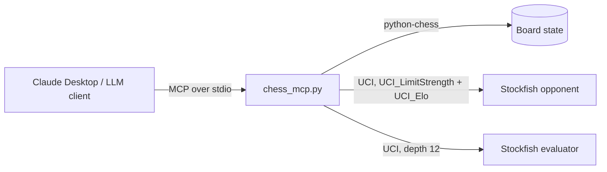

# chess-games

**Claude vs Stockfish: an MCP server and evaluation harness for measuring how a frontier LLM plays chess against a strength-limited engine.**

A language model picks its own moves from a text board. Stockfish, capped at a chosen Elo, answers each one. A separate full-strength Stockfish scores every position, so each game produces a per-move evaluation curve that shows exactly where the model's play breaks down.

---

## Why

Public LLM chess leaderboards report a single rating. This project asks a more useful question: *at what point, and why, does an LLM lose a position?* Recording an objective centipawn evaluation after every half-move turns each game into a diagnostic trace, not just a result.

## Architecture



- **The server owns the board and the engine.** The model never sees engine analysis for its own move. It gets the position, the legal moves and an evaluation for context, so the match stays fair.
- **Every move is checked for legality** with `python-chess` (`parse_san`). Illegal moves are rejected and the server returns the list of legal moves.
- **Two engine roles.** An Elo-limited Stockfish plays the opponent (`UCI_LimitStrength`, `UCI_Elo`, 0.3 s per move), and a full-strength Stockfish at depth 12 produces the objective evaluation.
- **UCI is handled by `python-chess`** (`chess.engine.SimpleEngine.popen_uci`), so the only external dependency is a Stockfish binary.

## Repository layout

| Path | Purpose |
|---|---|
| `chess_mcp.py` | MCP server exposing `new_game`, `get_board`, `play_move` and `pgn` to any MCP client (e.g. Claude Desktop). |
| `engine_game.py` | Stateless CLI harness (`new` / `mymove` / `pgn`) with per-game JSON state, used to run the Elo ladder. |
| `setup.sh` | One-command macOS setup: installs Stockfish via Homebrew and builds a Python venv. |
| `requirements.txt` | Python dependencies (`chess`, `mcp`). |
| `claude_desktop_config.example.json` | `mcpServers` snippet for registering the server in Claude Desktop. |
| `games/*.pgn` | The four ladder games. |
| `evals.json` | Per-half-move centipawn evaluations, peak advantage and the decisive mistake for each game. |

## Quick start

**Requirements:** macOS with [Homebrew](https://brew.sh) and Python 3.10+. On Linux, install Stockfish with your package manager and run `pip install -r requirements.txt`.

```bash
git clone https://github.com/Data-Scientist-Sahil/chess-games.git
cd chess-games
chmod +x setup.sh
./setup.sh
```

### Option A: let Claude Desktop play (MCP server)

1. Open `~/Library/Application Support/Claude/claude_desktop_config.json`.
2. Merge in the `chess` entry from `claude_desktop_config.example.json`. Replace `/ABSOLUTE/PATH/TO/chess-games` with the repository's absolute path, so that `command` points at `venv/bin/python` and `args` points at `chess_mcp.py`.
3. Fully quit and reopen Claude Desktop. The `chess` tools should appear in the tools menu.
4. Start a game with a prompt like:

   > Start a new game as White against Stockfish at 1500 Elo. Before each move, call `get_board`, think it through, then call `play_move`. Continue until the game ends without asking me anything. Then call `pgn`.

| Tool | Description |
|---|---|
| `new_game(color, elo)` | Starts a game. `color` is the model's side; `elo` is Stockfish's strength (clamped to 1320–3190). |
| `get_board()` | Board diagram, FEN, legal moves in SAN, objective evaluation. |
| `play_move(san)` | Validates and plays the model's move; Stockfish replies automatically. |
| `pgn()` | Full game as PGN. Paste into [lichess.org/paste](https://lichess.org/paste) to replay. |

### Option B: run the CLI harness

```bash
source venv/bin/activate
python engine_game.py new demo 1500     # new game, you are White, Stockfish at 1500
python engine_game.py mymove demo e4    # play e4; Stockfish replies; prints board + eval
python engine_game.py pgn demo          # PGN plus the evaluation list
```

### Configuration

| Variable | Default | Used by |
|---|---|---|
| `STOCKFISH_PATH` | `stockfish` (on `PATH` after `brew install`) | both scripts |
| `GAME_DIR` | `./game_state` | `engine_game.py` |

## Results: Elo ladder (2026-11-14)

One game per level, with Claude (labelled *Opus 4.8* in the harness) as White against Stockfish at four strengths. Evaluations are in pawns from White's point of view, from a full-strength Stockfish at depth 12.

| Stockfish Elo | Moves | Peak advantage | Decisive mistake | Outcome |
|---|---|---|---|---|
| 1350 | 29 | **+8.97** | `16.Nc7+?` – unsound fork, the square was covered by the d8 bishop | Resigned |
| 1800 | 19 | +4.93 | `18.Bf3?` – hung the bishop to the e4 pawn | Resigned |
| 2200 | 23 | +3.08 | `21.Rxb6?` – traded off the key defensive rook | Resigned |
| 2600 | 14 | +0.94 | `12.c3?` – defended a pinned knight with a pawn; `...c5` won it | Resigned |

The PGN files carry the result tag `*` because each game was stopped by resignation, not played to checkmate.

### Findings

- **The opening play was sound in every game.** The model reached an equal or winning position against all four opponents, including a near-decisive +9 against the 1350 engine.
- **Each game was lost in a single move.** The evaluation curve stays positive and then drops by 4 to 9 pawns in one half-move, every time.
- **The failure mode was the same each time:** a plausible move whose refutation was one concrete tactical line (a covered fork square, a pawn capture, a pin).
- **Interpretation:** the model plays from strong pattern intuition but is an unreliable verifier of forcing lines. That suggests a generator-plus-verifier design, where an LLM proposes and a search engine checks. The same pattern applies to LLM agents outside chess.

**Limitations:** one game per level, a single colour and a single model, so this is a diagnostic study, not a rating. A robust estimate needs several games per level with alternating colours.

## Roadmap

- Multi-game support (a `game_id` per session) so several chats can play in parallel.
- Batch runner over the API with alternating colours, and an Elo estimate with confidence intervals.
- Optional tool that lets the model request a blunder check before committing a move, to measure how much a verifier helps.

## License

MIT
